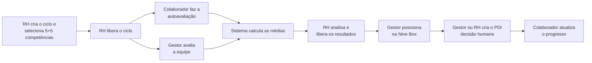
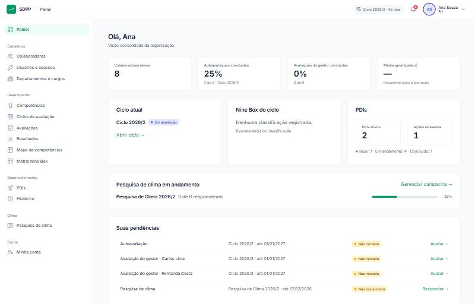
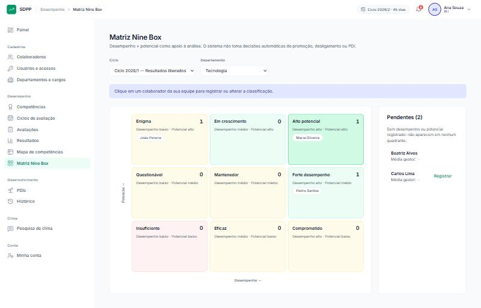
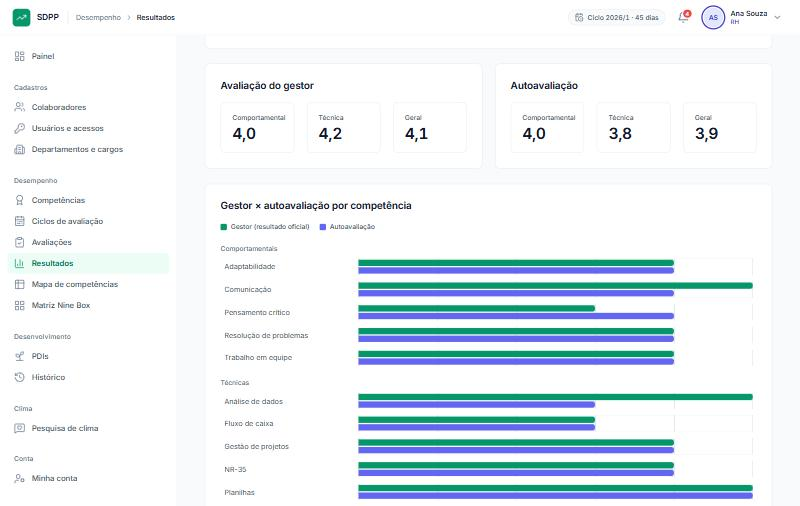
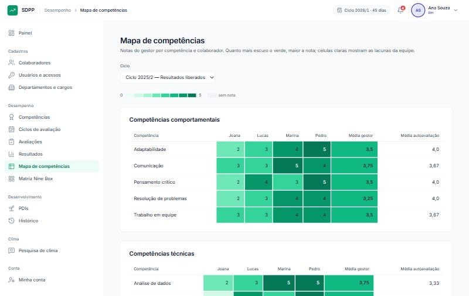
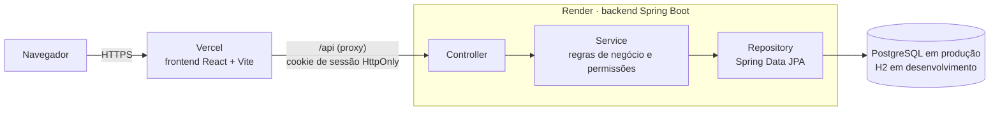

# SDPP – Sistema de Desenvolvimento e Performance de Pessoas

[](https://github.com/MarcusMikael/sistema-planilhas/actions/workflows/ci.yml)

**Acesse o sistema:** https://sdpp-frontend-eta.vercel.app (contas em [Contas de demonstração](#contas-de-demonstração))

Criado em 2026.2 na disciplina **Liderança e Gestão de Pessoas** (Engenharia de Software – UNIFSA), sob
orientação do prof. Aluysio Ricardo Nunes Fonseca, seguindo o **Documento de Requisitos de Software (DRS v0.2)**
e o **Documento de Arquitetura (SWEBOK)** da equipe fundadora. A equipe atual está em [Equipe](#equipe), e o
histórico de todas as equipes, em [EQUIPES.md](EQUIPES.md).

## Sumário

- [Sobre o projeto](#sobre-o-projeto)
- [Como executar](#como-executar)
- [Contas de demonstração](#contas-de-demonstração)
- [Testes e integração contínua](#testes-e-integração-contínua)
- [Arquitetura](#arquitetura)
- [Segurança](#segurança)
- [Deploy](#deploy)
- [Referência da API](#referência-da-api)
- [Regras de negócio e rastreabilidade](#regras-de-negócio-e-rastreabilidade)
- [Decisões sobre pontos em aberto](#decisões-sobre-pontos-em-aberto)
- [Equipe](#equipe)
- [Como continuar este projeto](#como-continuar-este-projeto)
- [Licença](#licença)

---

## Sobre o projeto

### O problema

Hoje os processos de desenvolvimento e performance de pessoas são controlados em **quatro planilhas
isoladas** (modelos Convenia 2025). Cada processo tem seu próprio arquivo, sem controle de acesso por perfil,
sem histórico consolidado e com limitações como notas sem validação e células vazias contadas como zero.

### A solução

O SDPP é um **sistema web único** que centraliza esses processos em um banco de dados. Assim, a informação de
um módulo alimenta os outros (por exemplo, o resultado da avaliação apoia a Nine Box e o PDI), e cada pessoa
vê e faz apenas o que o seu perfil permite.

| Planilha original | Módulo no SDPP | O que o sistema faz |
|---|---|---|
| Avaliação de Desempenho por Competência | **Ciclos e Avaliações** | Catálogo de 20 competências; ciclos com 5 comportamentais + 5 técnicas; autoavaliação e avaliação do gestor (notas de 0 a 5); médias; liberação de resultados; mapa de competências |
| Matriz Nine Box | **Nine Box** | Matriz 3×3 de desempenho × potencial, com descrição e plano de ação sugerido para cada quadrante |
| Modelo de PDI | **PDI** | Plano de Desenvolvimento Individual com objetivo, habilidades e ações com prazo, entrega, recursos, status e progresso |
| Questionário de Pesquisa de Clima | **Pesquisa de clima** | Campanhas com o questionário de 20 perguntas, respostas anônimas e resultados só agregados |

Além disso, o sistema tem **login com perfis**, **cadastro de colaboradores**, **indicadores** e o
**histórico** de cada pessoa.

### Perfis de usuário

| Perfil | O que faz no sistema |
|---|---|
| **RH** | Cadastra colaboradores, contas, departamentos, cargos e competências; cria e libera ciclos; libera os resultados; publica pesquisas de clima e vê os resultados agregados; acompanha os indicadores da organização |
| **Gestor** | Avalia e acompanha a **sua equipe** (definida pelo "gestor responsável" no cadastro); registra a Nine Box; cria e acompanha PDIs; vê os indicadores da equipe |
| **Colaborador** | Faz a autoavaliação; consulta os próprios resultados depois que o RH libera; atualiza o progresso do próprio PDI; responde à pesquisa de clima |

Todas as permissões são verificadas no backend: um colaborador não acessa dados de outro, e um gestor só
acessa a própria equipe. Quem tem perfil RH e também é gestor de alguém no cadastro avalia essa equipe da mesma
forma que um gestor.

### Fluxo principal



A pesquisa de clima corre em paralelo: o RH publica a campanha, cada colaborador responde uma única vez e, depois
de encerrada, o RH consulta as médias por pergunta e por setor (só grupos com pelo menos 5 respostas).

### Telas

Capturas com os dados fictícios de demonstração.

| Painel do RH | Matriz Nine Box |
|---|---|
|  |  |
| **Resultados: gestor × autoavaliação** | **Mapa de competências** |
|  |  |

---

## Como executar

### 1. Pré-requisitos

| Ferramenta | Versão | Como verificar |
|---|---|---|
| JDK (Java) | **21** | `java -version` |
| Node.js | **22 LTS** (ou 20.19+) | `node -v` |
| Git | qualquer | `git --version` |

Não é preciso instalar Maven nem banco de dados: o projeto usa o Maven Wrapper (`mvnw`) e, em
desenvolvimento, um banco H2 criado automaticamente na pasta `data/`.

> No Windows, se faltar algo: `winget install EclipseAdoptium.Temurin.21.JDK` e
> `winget install OpenJS.NodeJS.LTS`. Feche e reabra o terminal depois de instalar.

### 2. Obter o código

```bash
git clone https://github.com/MarcusMikael/sistema-planilhas.git
cd sistema-planilhas
```

### 3. Subir o backend (porta 8080)

Na raiz do projeto:

```bash
./mvnw spring-boot:run
```

No Windows (PowerShell ou Prompt de Comando), use:

```powershell
.\mvnw.cmd spring-boot:run
```

A primeira execução baixa as dependências e leva alguns minutos. O backend está pronto quando aparecer no log
`Started SdppBackendApplication` e, na primeira vez, `Dados de demonstração carregados`.

### 4. Subir o frontend (porta 5173)

Em **outro terminal**:

```bash
cd frontend
npm install
npm run dev
```

`npm install` só é necessário na primeira vez ou quando as dependências mudarem.

### 5. Acessar

Abra **http://localhost:5173** e entre com uma das [contas de demonstração](#contas-de-demonstração). Em
desenvolvimento, o Vite encaminha as chamadas `/api` para o backend na porta 8080.

### Recomeçar do zero

Pare o backend, apague a pasta `data/` e suba de novo. O banco é recriado com os dados de demonstração.

### Problemas comuns

| Sintoma | Causa provável e solução |
|---|---|
| `java` não é reconhecido / `JAVA_HOME` inválido | JDK 21 não instalado ou fora do PATH. Instale e reabra o terminal; se necessário, defina `JAVA_HOME` com a pasta do JDK |
| `Port 8080 was already in use` | Outro backend já está rodando. Feche-o ou suba em outra porta com a variável `PORT` (ex.: `PORT=8081 ./mvnw spring-boot:run`) e ajuste o endereço do proxy `/api` em `frontend/vite.config.js` |
| Tela de login mostra "Não foi possível conectar ao servidor" | O backend não está no ar ou ainda está iniciando |
| `npm` não é reconhecido | Node.js não instalado ou terminal aberto antes da instalação |
| Login com "E-mail ou senha inválidos" | Confira a senha `sdpp123`. Se o banco foi criado por uma versão antiga, apague `data/` |
| "Muitas tentativas de login sem sucesso" | 5 senhas erradas em 15 minutos bloqueiam a conta para navegadores desconhecidos; o navegador onde a pessoa já entrou continua liberado (ver [Segurança](#segurança)). Espere o tempo indicado ou entre de um navegador onde a conta já foi usada |
| "Acordando o servidor…" no site publicado | O Render desligou o backend por falta de uso; o primeiro acesso leva até 1 minuto (ver [Deploy](#deploy)) |
| Erros de banco depois de atualizar o código | O esquema mudou; apague `data/` (em desenvolvimento) |

### Gerar a versão de distribuição

```bash
./mvnw clean package                         # gera target/sdpp-backend-0.0.1-SNAPSHOT.jar
java -jar target/sdpp-backend-0.0.1-SNAPSHOT.jar

cd frontend && npm run build                 # gera frontend/dist (arquivos estáticos)
```

---

## Contas de demonstração

Criadas automaticamente quando o banco está vazio (perfil `dev`, ou `SDPP_SEED_DEMO=true` em produção). Todos
os dados são **fictícios** (restrição RES-02 do DRS). **Senha de todas as contas: `sdpp123`.** Na tela de login,
os botões das contas de demonstração entram com um clique.

Os dados simulam a equipe de Tecnologia de uma empresa fictícia, com uma situação diferente para cada pessoa:

| Pessoa | E-mail | Situação nos dados |
|---|---|---|
| **Ana Souza** (RH) | `rh@sdpp.local` | Conduz os ciclos de avaliação e a pesquisa de clima e acompanha os indicadores da empresa |
| **Carlos Lima** (Gestor) | `gestor@sdpp.local` | Gerencia a equipe de Tecnologia: avalia, posiciona na Nine Box e acompanha os PDIs |
| **Maria Oliveira** | `maria@sdpp.local` | Destaque da equipe: *Alto potencial* na Nine Box, com PDI para assumir a liderança técnica |
| **Pedro Santos** | `pedro@sdpp.local` | Sólido e constante: *Forte desempenho*; gestor 4,1 × autoavaliação 3,9 (caso de referência do DRS) |
| **João Pereira** | `joao@sdpp.local` | Tem potencial, mas não está entregando: *Enigma*; PDI em andamento com uma ação atrasada |
| **Beatriz Alves** | `beatriz@sdpp.local` | Recém-chegada: ainda sem Nine Box e com a autoavaliação do ciclo atual pendente |
| Fernanda Costa (Gestora) | `gestora.comercial@sdpp.local` | Equipe Comercial; mostra que um gestor não vê a equipe de outro |
| Rafael Mendes | `rafael@sdpp.local` | Único colaborador do Comercial (equipe da Fernanda) |

> **Contas de demonstração em sites publicados.** Na versão publicada pela equipe fundadora, elas ficaram ativas
> **de propósito**, para apresentar o sistema. Como a senha é pública, quem publicar uma versão deve decidir se
> quer mantê-las: para uso real, troque as senhas (ou desative as contas) em *Usuários e acessos*, defina
> `SDPP_SEED_DEMO=false` no servidor e `VITE_OCULTAR_CONTAS_DEMO=true` no frontend (esconde os atalhos do login).

Situação montada (os nomes de ciclos e pesquisas seguem o semestre em que o banco foi criado, por exemplo
*Ciclo 2026/2*):

- catálogo de 20 competências e os 9 quadrantes da Nine Box, conforme as planilhas;
- **ciclo do semestre passado**, com resultados liberados: gráficos, mapa de competências e Nine Box preenchida
  (só a Beatriz pendente);
- **ciclo do semestre atual**, aberto: Maria e Pedro já se autoavaliaram; João e Beatriz ainda não; todas as
  avaliações do Carlos estão pendentes;
- **PDIs** da Maria (em dia) e do João (com uma ação atrasada);
- **pesquisa de clima do semestre atual**, aberta, já respondida por Pedro, João e Rafael (Maria, Beatriz e
  Carlos podem responder);
- **pesquisa de clima do semestre passado**, encerrada, com resultados agregados (Tecnologia e Comercial, abaixo
  do mínimo de 5 respostas cada, aparecem reunidos em um só grupo).

**Como explorar o sistema:**

1. Entre como **Beatriz** e faça a autoavaliação em *Minha autoavaliação*.
2. Entre como **Carlos**, avalie a equipe em *Avaliações* e veja a *Matriz Nine Box* e o PDI do João.
3. Entre como **Ana**, veja os indicadores e os resultados da pesquisa encerrada; em *Ciclos de avaliação*, abra
   o ciclo atual e clique em *Liberar resultados*.
4. Volte como **Maria** e veja *Meus resultados*.

---

## Testes e integração contínua

| Conjunto | Comando | O que cobre |
|---|---|---|
| **Backend** | `./mvnw test` | Casos dourados de cálculo do DRS (Seção 6.1), critérios de aceitação de permissões e regras de negócio, limite de login, sessão por cookie e anonimato do clima. Usa H2 em memória |
| **Frontend** (testes e lint) | `cd frontend`, depois `npm test` e `npm run lint` | Vitest + Testing Library: login, cabeçalho, gráficos, controle de notas, rascunho automático, modais (foco e alterações não salvas), aviso ao sair, Error Boundary, corrida de requisições no `useApi`, política de senha. ESLint com as regras de hooks do React |
| **Ponta a ponta** | `node scripts/e2e-api.mjs` | Ciclo completo com os três perfis, matriz de permissões, Nine Box, PDI, pesquisa de clima e cadastros, contra o servidor real |

O roteiro ponta a ponta precisa do backend no ar com o banco de demonstração recém-criado (apague `data/` e
reinicie o backend antes). Cada comando mostra ao final quantos testes ou verificações rodaram e quantos falharam;
os totais atualizados também aparecem em cada execução do CI.

**Integração contínua.** O GitHub Actions ([`.github/workflows/ci.yml`](.github/workflows/ci.yml)) roda os três
conjuntos em todo pull request e em cada push na `main`; o roteiro ponta a ponta sobe o backend real com os dados
de demonstração. Para impedir o merge quando algo falha, o dono do repositório ativa em *Settings → Branches*
uma regra para a `main` exigindo os checks *Backend*, *Frontend* e *Ponta a ponta*.

---

## Arquitetura

Aplicação web em camadas, com o frontend consumindo uma API REST. Só o backend acessa o banco de dados. Em
produção, a Vercel serve o frontend e repassa `/api` ao backend no Render, então navegador, frontend e API ficam
no mesmo domínio.



| Camada | Tecnologia |
|---|---|
| Backend | Java 21, Spring Boot 4.1, Spring Security (JWT em cookie HttpOnly + BCrypt), Spring Data JPA / Hibernate, Bean Validation |
| Banco de dados | H2 em arquivo (desenvolvimento, sem instalação) · PostgreSQL (produção) |
| Frontend | React 18, React Router 7, Vite 8, ícones Lucide |
| Testes | JUnit 5, Spring MockMvc, AssertJ · Vitest, Testing Library · ESLint · roteiro ponta a ponta em Node.js |
| Integração e deploy | GitHub Actions · Vercel (frontend) · Render com Docker (backend e PostgreSQL) |

### Estrutura do repositório

```
sistema-planilhas/
├── pom.xml, mvnw, mvnw.cmd           Build do backend (Maven Wrapper)
├── Dockerfile                        Imagem de produção do backend (Render)
├── .github/workflows/ci.yml          Integração contínua (testes em todo PR)
├── src/main/java/sdpp_backend/
│   ├── config/                       Segurança, propriedades e carga inicial (DataInitializer)
│   ├── security/                     JWT, cookie de sessão, limite de login e regras de acesso por equipe
│   ├── controller/                   Rotas REST (/api/...)
│   ├── service/                      Regras de negócio; service/calculo = médias, Nine Box e agrupamento do clima
│   ├── repository/                   Acesso a dados (Spring Data JPA)
│   ├── model/ e model/enums/         Entidades e domínios (perfis, status, níveis...)
│   ├── dto/                          Objetos de entrada/saída da API, com validação
│   └── exception/                    Erros padronizados (400, 401, 403, 404, 409, 422, 429)
├── src/main/resources/
│   ├── application.properties        Configuração comum e parâmetros das regras (sdpp.*)
│   ├── application-dev.properties    H2 em arquivo e dados de demonstração (padrão)
│   └── application-prod.properties   PostgreSQL e cookie seguro via variáveis de ambiente
├── src/test/                         Testes automatizados do backend
├── scripts/e2e-api.mjs               Teste ponta a ponta da API
├── docs/imagens/                     Capturas de tela usadas neste README
└── frontend/
    ├── src/pages/                    Telas (painel, avaliações, Nine Box, PDI, clima...) e seus testes
    ├── src/components/               Layout, cabeçalho, gráficos e componentes de interface
    ├── src/api, auth, hooks          Cliente da API (api.js), sessão do usuário (auth.jsx) e hooks (hooks.js)
    ├── eslint.config.js              Regras de lint
    └── vite.config.js, vercel.json   Servidor de desenvolvimento, testes e deploy (proxy e cabeçalhos)
```

### Parâmetros configuráveis

Ficam em `src/main/resources/application.properties`. Servem para regras ainda pendentes de validação
pelo RH ou pelo professor:

| Propriedade | Padrão | Uso |
|---|---|---|
| `sdpp.ninebox.limite-medio` / `limite-alto` | 2.5 / 3.75 | Faixas para sugerir o desempenho na Nine Box |
| `sdpp.clima.minimo-respostas` | 5 | Mínimo de respostas para exibir um resultado de clima |
| `sdpp.jwt.expiracao-horas` | 8 | Duração da sessão |
| `sdpp.seed.demo` | `true` só no perfil dev | Carrega os dados de demonstração |

---

## Segurança

**Sessão.** O login grava o token (JWT) em um cookie `HttpOnly` (`sdpp_sessao`, `SameSite=Lax`, `Secure` em
produção): o JavaScript da página não tem acesso a ele, então um eventual XSS não consegue roubar a sessão.
Trocar a senha (ou o RH redefini-la) invalida as sessões anteriores. Clientes de API (testes,
`scripts/e2e-api.mjs`) usam `Authorization: Bearer <token>` com o token devolvido no corpo do login.

**CSRF.** Requisições que alteram dados com autenticação por cookie exigem o cabeçalho `X-SDPP-CSRF`, que o
frontend envia sempre e um site de terceiros não consegue enviar.

**Limite de tentativas de login.** Os contadores ficam no banco e não zeram quando o Render reinicia:

- de um navegador desconhecido, 5 senhas erradas em 15 minutos bloqueiam a conta, e 50 erradas no total (em
  qualquer conta) bloqueiam novos navegadores, contra quem testa uma senha comum em muitas contas;
- o navegador onde a pessoa já entrou recebe um cookie de dispositivo assinado (`sdpp_dispositivo`, 180 dias)
  e tem contador próprio: alguém errando a senha de propósito em outro lugar não bloqueia o dono da conta.
  **Dica para demonstrações:** entre uma vez com cada conta no computador que será usado, antes de começar.

**Senhas.** BCrypt; senhas novas precisam de ao menos 8 caracteres, com letras e números (as contas de
demonstração mantêm `sdpp123`, pois são criadas direto no banco).

**Cabeçalhos HTTP** (`vercel.json`): Content-Security-Policy restritiva, `X-Frame-Options: DENY`, `nosniff`,
`Referrer-Policy` e `Permissions-Policy`.

**Permissões e anonimato.** Toda regra de acesso (perfil, pessoa e equipe) é verificada no backend
(`AcessoService`). As respostas do clima ficam separadas de quem respondeu, os resultados só saem depois de
encerrada a pesquisa e setores pequenos são agrupados para impedir que uma resposta seja deduzida por subtração.

---

## Deploy

### Backend no Render (Docker)

O `Dockerfile` gera a imagem de produção: perfil `prod`, PostgreSQL, execução sem privilégios de root, fuso de
Brasília e inicialização acelerada. Variáveis de ambiente:

| Variável | Exemplo |
|---|---|
| `DATABASE_URL` | `jdbc:postgresql://host:5432/sdpp` |
| `DATABASE_USERNAME` / `DATABASE_PASSWORD` | credenciais do banco |
| `SDPP_JWT_SECRET` | segredo aleatório com 32 ou mais caracteres (**obrigatório**: sem ele o backend não sobe) |
| `SDPP_SEED_DEMO` | `true` para criar as contas de demonstração em um banco vazio |
| `SDPP_CORS_ORIGENS` | URL do frontend (com o proxy da Vercel o CORS nem chega a ser usado) |
| `SDPP_COOKIE_SECURE` / `SDPP_COOKIE_SAMESITE` | padrão `true` / `Lax`; não precisa alterar |
| `JAVA_OPTS` | opcional: substitui os ajustes padrão da JVM |

No painel do Render, use `/api/saude` como *Health Check Path* (rota pública e leve, que não consulta o banco).

### Frontend na Vercel

- diretório raiz: `frontend`; comando de build: `npm run build`; pasta de saída: `dist`;
- **não** defina `VITE_API_URL`: o frontend chama `/api` no próprio domínio.

O `vercel.json` repassa `/api` ao backend, redireciona as demais rotas para o `index.html` e define os cabeçalhos
de segurança. O destino do proxy é o endereço do backend no Render: na versão da equipe fundadora,
`sistema-planilhas-najb.onrender.com`. Quem publicar outra versão (ou mudar o serviço de endereço) precisa
trocá-lo ali.
Com o proxy, o cookie de sessão funciona em todos os navegadores, inclusive Safari e iPhone, que bloqueiam
cookies entre domínios diferentes.

### Fuso horário

O `Dockerfile` fixa o fuso `America/Sao_Paulo` (variável `TZ` e `-Duser.timezone`). O Render roda em UTC, 3 horas
à frente: sem isso, entre 21h e meia-noite o sistema já consideraria o dia seguinte (prazos de ciclo e de
clima, datas de conclusão, ações atrasadas).

### Primeiro acesso lento (Render gratuito)

No plano gratuito, o Render desliga o backend depois de cerca de 15 minutos sem uso, e o próximo acesso leva de
30 segundos a 1 minuto. Para amenizar:

- **Aviso na tela:** se uma requisição passar de 3 segundos, aparece "Acordando o servidor…".
- **Inicialização mais rápida:** o `Dockerfile` extrai o jar e gera um arquivo de CDS (Class Data Sharing)
  durante o build, além de ajustar a JVM para pouca CPU. Em medição local, o tempo até o contexto do Spring
  ficar pronto caiu de cerca de 9,3 s para 4,9 s.

Para eliminar a espera: use uma instância paga ou, perto de demonstrações, um serviço de ping gratuito (por
exemplo, UptimeRobot) chamando `https://<seu-backend>.onrender.com/api/saude` a cada 10 minutos (na versão da
equipe fundadora, `https://sistema-planilhas-najb.onrender.com/api/saude`).

### Banco de dados em produção

- **Backup:** o PostgreSQL gratuito do Render não tem backup automático e tem prazo de validade (confira a data
  no painel do Render). Antes de demonstrações e de mudanças grandes, gere uma cópia com a *External Database
  URL* do painel:

  ```bash
  pg_dump "URL_EXTERNA_DO_BANCO" --no-owner --format=custom --file=sdpp-backup.dump
  ```

  Para restaurar em um banco novo: `pg_restore --no-owner --dbname "URL_DO_BANCO_NOVO" sdpp-backup.dump`.
- **Esquema:** o Hibernate atualiza as tabelas sozinho (`ddl-auto=update`): cria tabelas e colunas novas, mas
  nunca apaga nem altera colunas existentes. Mudanças desse tipo (renomear, mudar tipo, remover) exigem SQL
  manual. Se o projeto continuar depois da disciplina, o próximo passo é adotar migrações versionadas (Flyway),
  gerando a primeira a partir do esquema real de produção.

### Decisão sobre o risco R-01 (Arquitetura 7.2)

A Vercel não executa Java. **Decisão adotada:** frontend na Vercel e backend com PostgreSQL no Render (Docker),
ligados pelo proxy `/api` do `vercel.json`.

---

## Referência da API

Todas as rotas ficam em `/api`. O navegador se autentica pelo cookie de sessão (ver [Segurança](#segurança));
clientes de API usam `Authorization: Bearer <token>`. São públicas apenas `POST /api/auth/login`,
`POST /api/auth/logout` e `GET /api/saude`.

Os erros seguem a estrutura `{status, erro, mensagem, campos, timestamp}`:

| Código | Significado |
|---|---|
| 400 | validação (`campos` traz o erro de cada campo) |
| 401 | não autenticado |
| 403 | sem permissão |
| 404 | não encontrado |
| 409 | duplicidade ou registro em uso |
| 422 | regra de negócio |
| 429 | muitas tentativas de login |

| Recurso | Principais operações |
|---|---|
| `/api/auth` | `login`, `logout`, `me`, `senha` (devolve um token novo e invalida os anteriores) |
| `/api/saude` | verificação de saúde (pública) |
| `/api/usuarios` | CRUD (RH); exclusão lógica |
| `/api/colaboradores` | listar conforme a equipe, CRUD (RH), `/equipe`, `/{id}/historico` |
| `/api/departamentos`, `/api/cargos` | CRUD (RH) |
| `/api/competencias` | catálogo editável (RH) |
| `/api/ciclos` | CRUD, `/{id}/competencias`, `/{id}/liberar`, `/{id}/liberar-resultados`, `/{id}/resultados/{colaboradorId}`, `/{id}/mapa-competencias` |
| `/api/avaliacoes` | `pendentes`, abrir, `/{id}/notas`, `/{id}/concluir` |
| `/api/nine-box` | matriz por ciclo, registro do gestor, `quadrantes` |
| `/api/pdis`, `/api/acoes-pdi` | PDI e ações; `PATCH /acoes-pdi/{id}/progresso` |
| `/api/pesquisas-clima` | campanhas, perguntas, `publicar`, `encerrar`, `respostas`, `resultados` (só agregados e só depois de encerrar) |
| `/api/indicadores` | indicadores no escopo do perfil |

---

## Regras de negócio e rastreabilidade

| Regra do DRS | Onde está implementada |
|---|---|
| RN-01 avaliações independentes | `UNIQUE(colaborador, ciclo, tipo)` em `avaliacao`; `AvaliacaoService` |
| RN-02 nota ausente ≠ zero | `pontuacao.nota` anulável; `CalculoMedias`; a conclusão exige todas as notas |
| RN-03/RN-12 eixos e quadrantes | `NineBoxModel` com eixos anuláveis + tabela `quadrante` |
| RN-04 sem decisão automática | nenhuma ação é disparada pela Nine Box; o PDI é sempre criado manualmente |
| RN-05 datas do PDI | `PDIService` (término ≥ início) |
| RN-06/RN-10 clima anônimo e resposta única | `participacao_clima` separada de `resposta` (sem colaborador, sem horário, id UUID aleatório); mínimo de 5 respostas por grupo; setores pequenos agrupados para impedir dedução por subtração (`AgrupamentoSetores`); resultados só após encerrar |
| RN-07 escala 0–5 | Bean Validation + `AvaliacaoService` |
| RN-08 5 + 5 competências | `CicloService.selecionarCompetencias` / `liberar` |
| RN-09 liberação de resultados | `ResultadoService` / `AvaliacaoService` (visibilidade) |
| RN-11 médias | `CalculoMedias` (testes em `CalculoMediasTest`) |
| RF-SEG-02 acesso por pessoa e equipe | `AcessoService` + regras por perfil no `SecurityConfig` e `@PreAuthorize` |

Regras complementares adotadas para manter os dados consistentes:

- o gestor responsável precisa ter acesso com perfil Gestor ou RH, e quem gere uma equipe ativa não pode ser
  desativado nem perder o acesso de gestão (`ColaboradorService`, `UsuarioService`);
- trocar o gestor durante o ciclo descarta o rascunho da avaliação do gestor anterior (`ColaboradorService`);
- avaliações só dentro do período do ciclo (`AvaliacaoService`);
- o e-mail do cadastro e o e-mail de acesso andam juntos (`ColaboradorService`, `UsuarioService`).

---

## Decisões sobre pontos em aberto

Os pontos em aberto (PA) do DRS que ainda não tinham definição foram resolvidos com os padrões abaixo.
**Precisam ser validados com o professor ou o RH.**

| PA | Decisão adotada | Onde mudar |
|---|---|---|
| PA-01/02 | A autoavaliação não entra no resultado final nem na Nine Box; aparece só para comparação | `ResultadoService` |
| PA-03/12 | Desempenho **sugerido** pela média do gestor (< 2,5 Baixo; < 3,75 Médio; senão Alto) e confirmado pelo gestor; potencial escolhido pelo gestor | `sdpp.ninebox.*` |
| PA-04 | Perguntas 2 a 20 usam a escala de 1 a 5; a 1 (setor) vem do cadastro. O RH pode editar as perguntas antes de publicar | `QuestionarioPadrao` |
| PA-06 | Mínimo de 5 respostas por grupo para exibir | `sdpp.clima.minimo-respostas` |
| PA-08 | Médio × Alto = "Em crescimento"; o RH pode editar rótulos e planos | `PUT /api/nine-box/quadrantes/{id}` |
| PA-10 | Notas inteiras de 0 a 5 | `PontuacaoModel` |
| PA-11 | O gestor pode avaliar sem esperar a autoavaliação | `AvaliacaoService` |
| PA-13 | PDI criado pelo RH ou pelo gestor do colaborador | `PDIService` |
| PA-14 | Contas criadas pelo RH; sem perfil administrador separado | `UsuarioService` |
| PA-15 | Nine Box: o gestor responsável (perfil Gestor ou RH) registra a da sua equipe, o RH consulta tudo e o colaborador não vê. Resultados de clima: só RH | `AcessoService` e services |
| PA-21/22 | Recursos em texto livre; status A fazer / Em andamento / Concluído | `AcaoPDIModel` |
| PA-23 | Setor copiado do departamento do cadastro | `PesquisaClimaService` |

---

## Equipe

Equipe responsável por esta versão. Os perfis no GitHub e o histórico de todas as equipes que
trabalharam no projeto ficam em [EQUIPES.md](EQUIPES.md).

| Campo | Informação |
|---|---|
| **Período letivo** | 2026.2 |
| **Turma** | 6º período, turno manhã |
| **Disciplina** | Liderança e Gestão de Pessoas |
| **Curso e instituição** | Engenharia de Software – UNIFSA |
| **Orientação** | Prof. Aluysio Ricardo Nunes Fonseca |

| Integrante |
|---|
| Antonio Neves Aguiar Neto |
| Marcos André dos Santos Soares |
| Carlos Arthur Moraes Gonçalves |
| João Pedro Lima Barbosa |
| Rodolfo Dheymison Ferreira Silva |
| João William Soares Teodomiro Setubal de Carvalho |
| Enzo Morais Gonçalves |
| Marcus Mikael Rodrigues Vieira |

---

## Como continuar este projeto

Para as próximas turmas que vão partir deste código:

1. **Copie o repositório.** Prefira o botão *Fork* do GitHub, que mantém o vínculo com o original. Se clonar e
   criar um repositório novo, registre o repositório de origem no campo **Partiu de** do `EQUIPES.md`.
2. **Registre a sua equipe** no topo de [EQUIPES.md](EQUIPES.md) (há um modelo no fim do arquivo), sem remover
   as anteriores, com o GitHub de cada integrante. Depois, atualize a seção [Equipe](#equipe) acima com
   período letivo, turma, disciplina, orientação e os nomes dos integrantes.
3. **Rode o projeto localmente** seguindo [Como executar](#como-executar) e confira os testes
   ([Testes e integração contínua](#testes-e-integração-contínua)): o CI passa a rodar no seu repositório.
4. **Publique a sua versão**, se for o caso, com novas contas na Vercel e no Render ([Deploy](#deploy)):
   - troque o endereço do backend no proxy `/api` do `frontend/vercel.json` (e no serviço de ping, se usar um);
   - gere um `SDPP_JWT_SECRET` novo e use um banco PostgreSQL próprio;
   - decida se mantém as [contas de demonstração](#contas-de-demonstração) (`SDPP_SEED_DEMO`); com a senha
     pública, só faz sentido para apresentar o sistema;
   - atualize os links do sistema publicado e do selo do CI no topo deste README.
5. **Revise os pontos em aberto** ([Decisões sobre pontos em aberto](#decisões-sobre-pontos-em-aberto)) com a
   orientação do seu período antes de mudar regras.
6. **Mantenha a documentação em dia:** se o visual mudar, refaça as capturas em `docs/imagens/` (seção
   [Telas](#telas)), e registre no `EQUIPES.md` as entregas do seu período.

---

## Licença

Distribuído sob a [licença MIT](LICENSE): o código pode ser usado, modificado e redistribuído livremente, desde
que o aviso de copyright e a licença sejam mantidos, o que preserva os créditos das equipes listadas em
[EQUIPES.md](EQUIPES.md).
