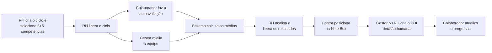
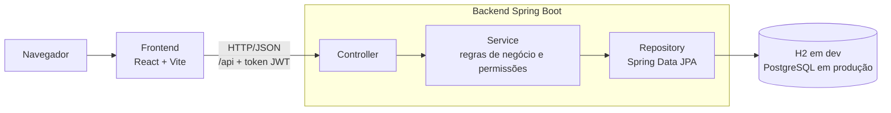

# SDPP – Sistema de Desenvolvimento e Performance de Pessoas

Projeto da disciplina **Gestão de Pessoas** (Engenharia de Software – UNIFSA, 2026), orientado pelo
professor Aluysio Fonseca. Segue o **Documento de Requisitos de Software (DRS v0.2)** e o **Documento de
Arquitetura (SWEBOK)** da equipe.

## Sumário

- [Sobre o projeto](#sobre-o-projeto)
- [Como executar](#como-executar)
- [Testes](#testes)
- [Estrutura do repositório](#estrutura-do-repositório)
- [Produção e deploy](#produção-e-deploy)
- [Referência da API](#referência-da-api)
- [Regras de negócio e rastreabilidade](#regras-de-negócio-e-rastreabilidade)
- [Decisões sobre pontos em aberto](#decisões-sobre-pontos-em-aberto)

---

## Sobre o projeto

### O problema

Hoje os processos de desenvolvimento e performance de pessoas são controlados em **quatro planilhas
isoladas** (modelos Convenia 2025). Cada processo tem seu próprio arquivo, sem controle de acesso por perfil,
sem histórico consolidado e com limitações como notas sem validação e células vazias contadas como zero.

### A solução

O SDPP é um **sistema web único** que centraliza esses processos em um banco de dados. Assim, a informação de
um módulo alimenta os outros (por exemplo, o resultado da avaliação apoia a Nine Box e o PDI), e cada pessoa
vê e faz apenas o que o seu perfil permite.

| Planilha original | Módulo no SDPP | O que o sistema faz |
|---|---|---|
| Avaliação de Desempenho por Competência | **Ciclos e Avaliações** | Catálogo de 20 competências; ciclos com 5 comportamentais + 5 técnicas; autoavaliação e avaliação do gestor (notas de 0 a 5); médias; liberação de resultados; mapa de competências |
| Matriz Nine Box | **Nine Box** | Matriz 3×3 de desempenho × potencial, com descrição e plano de ação sugerido para cada quadrante |
| Modelo de PDI | **PDI** | Plano de Desenvolvimento Individual com objetivo, habilidades e ações com prazo, entrega, recursos, status e progresso |
| Questionário de Pesquisa de Clima | **Pesquisa de clima** | Campanhas com o questionário de 20 perguntas, respostas anônimas e resultados só agregados |

Além disso, o sistema tem **login com perfis**, **cadastro de colaboradores**, **indicadores** e o
**histórico** de cada pessoa.

### Perfis de usuário

| Perfil | O que faz no sistema |
|---|---|
| **RH** | Cadastra colaboradores, contas, departamentos, cargos e competências; cria e libera ciclos; libera os resultados; publica pesquisas de clima e vê os resultados agregados; acompanha os indicadores da organização |
| **Gestor** | Avalia e acompanha a **sua equipe** (definida pelo "gestor responsável" no cadastro); registra a Nine Box; cria e acompanha PDIs; vê os indicadores da equipe |
| **Colaborador** | Faz a autoavaliação; consulta os próprios resultados depois que o RH libera; atualiza o progresso do próprio PDI; responde à pesquisa de clima |

Todas as permissões são verificadas no backend: um colaborador não acessa dados de outro, e um gestor só
acessa a própria equipe. Quem tem perfil RH e também é gestor de alguém no cadastro avalia essa equipe da mesma
forma que um gestor.

### Fluxo principal



A pesquisa de clima corre em paralelo: o RH publica a campanha, cada colaborador responde uma única vez e o RH
consulta as médias por pergunta e por setor. Grupos com menos de 5 respostas não são exibidos.

### Arquitetura

Aplicação web em camadas, com o frontend consumindo uma API REST. Só o backend acessa o banco de dados.



| Camada | Tecnologia |
|---|---|
| Backend | Java 21, Spring Boot 4.1, Spring Security (JWT + BCrypt), Spring Data JPA / Hibernate, Bean Validation |
| Banco de dados | H2 em arquivo (desenvolvimento, sem instalação) · PostgreSQL (produção) |
| Frontend | React 18, React Router, Vite 5 |
| Testes | JUnit 5, Spring MockMvc, AssertJ; roteiro ponta a ponta em Node.js |

---

## Como executar

### 1. Pré-requisitos

| Ferramenta | Versão | Como verificar |
|---|---|---|
| JDK (Java) | **21** | `java -version` |
| Node.js | **20 ou superior** (inclui o npm) | `node -v` |
| Git | qualquer | `git --version` |

Não é preciso instalar Maven nem banco de dados: o projeto usa o Maven Wrapper (`mvnw`) e, em
desenvolvimento, um banco H2 criado automaticamente na pasta `data/`.

> No Windows, se faltar algo: `winget install EclipseAdoptium.Temurin.21.JDK` e
> `winget install OpenJS.NodeJS.LTS`. Feche e reabra o terminal depois de instalar.

### 2. Obter o código

```bash
git clone <url-do-repositório>
cd sistema-planilhas
```

### 3. Subir o backend (porta 8080)

Na raiz do projeto:

```bash
./mvnw spring-boot:run
```

No Windows (PowerShell ou Prompt de Comando), use:

```powershell
.\mvnw.cmd spring-boot:run
```

A primeira execução baixa as dependências e leva alguns minutos. O backend está pronto quando aparecer no log
`Started SdppBackendApplication` e, na primeira vez, `Dados de demonstração carregados`.

### 4. Subir o frontend (porta 5173)

Em **outro terminal**:

```bash
cd frontend
npm install
npm run dev
```

`npm install` só é necessário na primeira vez ou quando as dependências mudarem.

### 5. Acessar

Abra **http://localhost:5173** e entre com uma das contas de demonstração abaixo. Em desenvolvimento, o Vite
encaminha as chamadas `/api` para o backend na porta 8080.

### Contas de demonstração

Criadas automaticamente quando o banco está vazio. Todos os dados são **fictícios** (restrição RES-02 do DRS).
**Senha de todas as contas: `sdpp123`.**

| Perfil | E-mail | Quem é |
|---|---|---|
| RH | `rh@sdpp.local` | Ana Souza – gestora do Carlos e da Fernanda |
| Gestor | `gestor@sdpp.local` | Carlos Lima – equipe de Tecnologia (Marina, Pedro, Joana, Lucas e Beatriz) |
| Gestor | `gestora.comercial@sdpp.local` | Fernanda Costa – equipe Comercial (Rafael) |
| Colaborador | `marina@sdpp.local` | Marina Oliveira – resultados do ciclo 2025/2: gestor 4,1 × autoavaliação 3,9 |
| Colaborador | `joana@sdpp.local` | Joana D'Ávila – tem um PDI com ações |
| Colaborador | `pedro@sdpp.local`, `lucas@sdpp.local`, `beatriz@sdpp.local`, `rafael@sdpp.local` | demais colaboradores |

Dados já carregados:

- catálogo de 20 competências e os 9 quadrantes da Nine Box, conforme as planilhas;
- **Ciclo 2025/2**, com resultados liberados e Nine Box parcialmente preenchida;
- **Ciclo 2026/1**, aberto para avaliações;
- um PDI e uma pesquisa de clima publicada, já com 5 respostas.

**Sugestão de roteiro para conhecer o sistema:**

1. Entre como **colaborador** (`marina@sdpp.local`) e faça a autoavaliação em *Minha autoavaliação*.
2. Entre como **gestor** (`gestor@sdpp.local`), avalie a equipe em *Avaliações* e veja a *Matriz Nine Box*.
3. Entre como **RH** (`rh@sdpp.local`), abra o *Ciclo 2026/1* em *Ciclos de avaliação* e clique em
   *Liberar resultados*.
4. Volte como colaborador e veja *Meus resultados*.

### Recomeçar do zero

Pare o backend, apague a pasta `data/` e suba de novo. O banco é recriado com os dados de demonstração.

### Problemas comuns

| Sintoma | Causa provável e solução |
|---|---|
| `java` não é reconhecido / `JAVA_HOME` inválido | JDK 21 não instalado ou fora do PATH. Instale e reabra o terminal; se necessário, defina `JAVA_HOME` com a pasta do JDK |
| `Port 8080 was already in use` | Outro backend já está rodando. Feche-o ou suba em outra porta com a variável `PORT` (ex.: `PORT=8081 ./mvnw spring-boot:run`) e ajuste o endereço do proxy `/api` em `frontend/vite.config.js` |
| Tela de login mostra "Não foi possível conectar ao servidor" | O backend não está no ar ou ainda está iniciando |
| `npm` não é reconhecido | Node.js não instalado ou terminal aberto antes da instalação |
| Login com "E-mail ou senha inválidos" | Confira a senha `sdpp123`. Se o banco foi criado por uma versão antiga, apague `data/` |
| Erros de banco depois de atualizar o código | O esquema mudou; apague `data/` (em desenvolvimento) |

### Gerar a versão de distribuição

```bash
./mvnw clean package                         # gera target/sdpp-backend-0.0.1-SNAPSHOT.jar
java -jar target/sdpp-backend-0.0.1-SNAPSHOT.jar

cd frontend && npm run build                 # gera frontend/dist (arquivos estáticos)
```

---

## Testes

**Testes automatizados do backend.** São 29 testes: os casos dourados de cálculo do DRS (Seção 6.1) e os
critérios de aceitação de permissões e regras de negócio. Usam um banco H2 em memória.

```bash
./mvnw test
```

**Teste ponta a ponta da API.** São 199 verificações contra o servidor real, incluindo:

- um ciclo completo com os três perfis;
- a matriz de permissões;
- Nine Box, PDI e pesquisa de clima;
- cadastros.

Requer o backend no ar com o banco de demonstração recém-criado (apague `data/` e reinicie o backend antes):

```bash
node scripts/e2e-api.mjs
```

---

## Estrutura do repositório

```
sistema-planilhas/
├── pom.xml, mvnw, mvnw.cmd           Build do backend (Maven Wrapper)
├── src/main/java/sdpp_backend/
│   ├── config/                       Segurança, propriedades e carga inicial (DataInitializer)
│   ├── security/                     JWT, filtro de autenticação e regras de acesso por equipe
│   ├── controller/                   Rotas REST (/api/...)
│   ├── service/                      Regras de negócio; service/calculo = médias e Nine Box
│   ├── repository/                   Acesso a dados (Spring Data JPA)
│   ├── model/ e model/enums/         Entidades e domínios (perfis, status, níveis...)
│   ├── dto/                          Objetos de entrada/saída da API, com validação
│   └── exception/                    Erros padronizados (400, 401, 403, 404, 409, 422)
├── src/main/resources/
│   ├── application.properties        Configuração comum e parâmetros das regras (sdpp.*)
│   ├── application-dev.properties    H2 em arquivo (padrão)
│   └── application-prod.properties   PostgreSQL via variáveis de ambiente
├── src/test/                         Testes automatizados
├── scripts/e2e-api.mjs               Teste ponta a ponta da API
└── frontend/
    ├── src/pages/                    Telas (painel, avaliações, Nine Box, PDI, clima...)
    ├── src/components/               Layout com menu por perfil e componentes de interface
    ├── src/api.js, auth.jsx          Cliente da API e sessão do usuário
    └── vite.config.js, vercel.json   Servidor de desenvolvimento e deploy
```

### Parâmetros configuráveis

Ficam em `src/main/resources/application.properties`. Servem para regras ainda pendentes de validação
pelo RH ou pelo professor:

| Propriedade | Padrão | Uso |
|---|---|---|
| `sdpp.ninebox.limite-medio` / `limite-alto` | 2.5 / 3.75 | Faixas para sugerir o desempenho na Nine Box |
| `sdpp.clima.minimo-respostas` | 5 | Mínimo de respostas para exibir um resultado de clima |
| `sdpp.jwt.expiracao-horas` | 8 | Duração da sessão |
| `sdpp.seed.demo` | `true` em dev | Carrega os dados de demonstração |

---

## Produção e deploy

Backend com o perfil `prod` e PostgreSQL, configurado por variáveis de ambiente:

| Variável | Exemplo |
|---|---|
| `SPRING_PROFILES_ACTIVE` | `prod` |
| `DATABASE_URL` | `jdbc:postgresql://host:5432/sdpp` |
| `DATABASE_USERNAME` / `DATABASE_PASSWORD` | credenciais do banco |
| `SDPP_JWT_SECRET` | segredo aleatório com 32 ou mais caracteres (**obrigatório**: sem ele o backend não sobe) |
| `SDPP_CORS_ORIGENS` | URL do frontend, ex.: `https://sdpp.vercel.app` |
| `SDPP_SEED_DEMO` | `true` só se quiser os dados de demonstração |

> **Use um banco PostgreSQL novo.** O esquema mudou em relação à versão anterior do backend: as colunas
> `peso`, `faixa` e `codigo_sessao` deixaram de existir e `resposta.id` virou UUID. O `ddl-auto=update` não
> remove colunas antigas obrigatórias, então um banco criado pela versão anterior causaria erros ao gravar.

Frontend na **Vercel**:

- diretório raiz: `frontend`;
- comando de build: `npm run build`;
- pasta de saída: `dist`;
- variável `VITE_API_URL` com a URL pública do backend.

O `vercel.json` já redireciona as rotas da aplicação para o `index.html`.

> **Risco R-01 (Arquitetura 7.2):** a Vercel não executa Java. A proposta é publicar o frontend na Vercel e o
> backend em uma plataforma com JVM ou contêiner (Render, Railway, Fly.io etc.). Confirmar com o professor.

---

## Referência da API

Todas as rotas ficam em `/api` e, exceto `POST /api/auth/login`, exigem o cabeçalho
`Authorization: Bearer <token>`. Os erros seguem a estrutura `{status, erro, mensagem, campos, timestamp}`:

| Código | Significado |
|---|---|
| 400 | validação |
| 401 | não autenticado |
| 403 | sem permissão |
| 404 | não encontrado |
| 409 | duplicidade ou registro em uso |
| 422 | regra de negócio |

| Recurso | Principais operações |
|---|---|
| `/api/auth` | `login`, `me`, `senha` |
| `/api/usuarios` | CRUD (RH); exclusão lógica |
| `/api/colaboradores` | listar conforme a equipe, CRUD (RH), `/equipe`, `/{id}/historico` |
| `/api/departamentos`, `/api/cargos` | CRUD (RH) |
| `/api/competencias` | catálogo editável (RH) |
| `/api/ciclos` | CRUD, `/{id}/competencias`, `/{id}/liberar`, `/{id}/liberar-resultados`, `/{id}/resultados/{colaboradorId}`, `/{id}/mapa-competencias` |
| `/api/avaliacoes` | `pendentes`, abrir, `/{id}/notas`, `/{id}/concluir` |
| `/api/nine-box` | matriz por ciclo, registro do gestor, `quadrantes` |
| `/api/pdis`, `/api/acoes-pdi` | PDI e ações; `PATCH /acoes-pdi/{id}/progresso` |
| `/api/pesquisas-clima` | campanhas, perguntas, `publicar`, `encerrar`, `respostas`, `resultados` (só agregados) |
| `/api/indicadores` | indicadores no escopo do perfil |

---

## Regras de negócio e rastreabilidade

| Regra do DRS | Onde está implementada |
|---|---|
| RN-01 avaliações independentes | `UNIQUE(colaborador, ciclo, tipo)` em `avaliacao`; `AvaliacaoService` |
| RN-02 nota ausente ≠ zero | `pontuacao.nota` anulável; `CalculoMedias`; a conclusão exige todas as notas |
| RN-03/RN-12 eixos e quadrantes | `NineBoxModel` com eixos anuláveis + tabela `quadrante` |
| RN-04 sem decisão automática | nenhuma ação é disparada pela Nine Box; o PDI é sempre criado manualmente |
| RN-05 datas do PDI | `PDIService` (término ≥ início) |
| RN-06/RN-10 clima anônimo e resposta única | `participacao_clima` separada de `resposta` (sem colaborador, sem horário, id UUID aleatório); mínimo de 5 respostas por grupo |
| RN-07 escala 0–5 | Bean Validation + `AvaliacaoService` |
| RN-08 5 + 5 competências | `CicloService.selecionarCompetencias` / `liberar` |
| RN-09 liberação de resultados | `ResultadoService` / `AvaliacaoService` (visibilidade) |
| RN-11 médias | `CalculoMedias` (testes em `CalculoMediasTest`) |
| RF-SEG-02 acesso por pessoa e equipe | `AcessoService` + regras por perfil no `SecurityConfig` e `@PreAuthorize` |

---

## Decisões sobre pontos em aberto

Os pontos em aberto (PA) do DRS que ainda não tinham definição foram resolvidos com os padrões abaixo.
**Precisam ser validados com o professor ou o RH.**

| PA | Decisão adotada | Onde mudar |
|---|---|---|
| PA-01/02 | A autoavaliação não entra no resultado final nem na Nine Box; aparece só para comparação | `ResultadoService` |
| PA-03/12 | Desempenho **sugerido** pela média do gestor (< 2,5 Baixo; < 3,75 Médio; senão Alto) e confirmado pelo gestor; potencial escolhido pelo gestor | `sdpp.ninebox.*` |
| PA-04 | Perguntas 2 a 20 usam a escala de 1 a 5; a 1 (setor) vem do cadastro. O RH pode editar as perguntas antes de publicar | `QuestionarioPadrao` |
| PA-06 | Mínimo de 5 respostas por grupo para exibir | `sdpp.clima.minimo-respostas` |
| PA-08 | Médio × Alto = "Em crescimento"; o RH pode editar rótulos e planos | `PUT /api/nine-box/quadrantes/{id}` |
| PA-10 | Notas inteiras de 0 a 5 | `PontuacaoModel` |
| PA-11 | O gestor pode avaliar sem esperar a autoavaliação | `AvaliacaoService` |
| PA-13 | PDI criado pelo RH ou pelo gestor do colaborador | `PDIService` |
| PA-14 | Contas criadas pelo RH; sem perfil administrador separado | `UsuarioService` |
| PA-15 | Nine Box: o gestor responsável (perfil Gestor ou RH) registra a da sua equipe, o RH consulta tudo e o colaborador não vê. Resultados de clima: só RH | `AcessoService` e services |
| PA-21/22 | Recursos em texto livre; status A fazer / Em andamento / Concluído | `AcaoPDIModel` |
| PA-23 | Setor copiado do departamento do cadastro | `PesquisaClimaService` |
